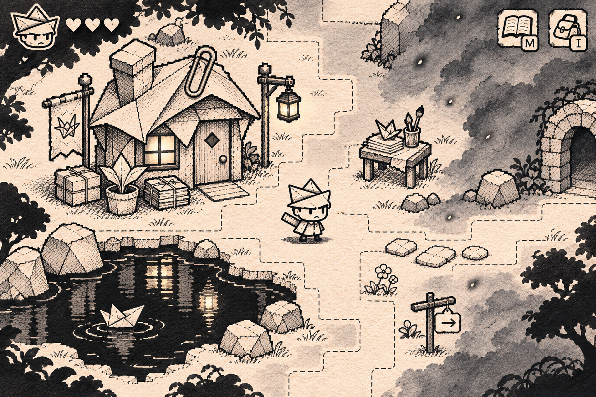
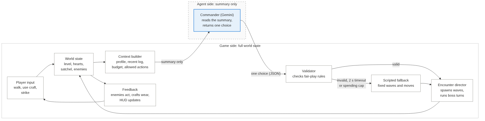

# Papersmith of the Crinkled Kingdom

> A grumpy old papersmith folds scraps into boats, darts, and shields to win back his wrecked workshop, while each region's boss, a sneaky commander, studies what he packs and sends pests to crumple it.

## Changes Since G1 - November 23, 2026

- The primary playtest metric is now the player's next action after each commander counter, not total crafts used per stage. Braintrust feedback identified that alternating between two crafts could inflate the old total without demonstrating meaningful adaptation.
- The commander context now tracks counters per craft across the whole stage. Evaluation case 9 covers a player alternating between two crafts and checks that the commander still recognizes and responds to that pattern without violating the variety cap.
- The Paper Woods critical path is now completable without the Pleated Fan. The first clue sits on an optional raised ledge that requires the Paper Frog.
- The G2/G3 checkpoint implements the Stage 1 browser-game slice, bounded Commander interface and fallback, deterministic evaluation, and Tech Lead-to-QA handoff. A live Gemini endpoint and external playtest remain open.
- A Threadbare-inspired usability pass replaces the hidden "cycle, then use" flow with context-sensitive prompts, direct ruler and craft actions, number-key selection, and clickable satchel slots. The old Enter/X flow remains as a fallback.
- Added an evidence-based Art / Design Lead after two player-facing revisions exposed missing ownership for renderer compatibility and interaction clarity. It briefs Tech Lead and reviews the implemented experience before independent QA.
- Added an evidence-based Producer / PM after tracker setup and gate closeout repeatedly split status across documents. It maintains planning, risk, PPP, and handoff records while the owner retains scope and gate decisions.
- **2026-11-25 — Restart:** The first G2/G3 checkpoint build was removed because it did not match the owner's vision (too many unknown controls, cognitive overload, too little level complexity). The vertical slice is rebuilt from the approved design brief `agent-team/design/2026-11-25-vertical-slice-brief.md` (revision 3).
- **2026-11-25 — Engine:** The game is built with Phaser and TypeScript instead of Three.js, for built-in 2D tilemaps and levels and an automatic Canvas fallback when WebGL is unavailable.
- **2026-11-25 — Controls:** Simplified to reduce cognitive load: arrows/WASD move; Space/E does the on-screen action and uses the selected fold; X attacks with the ruler; Tab switches folds in the order the player packed them. The mouse is used only to pack and fold, and those screens also have a keyboard alternative (arrows choose, Space confirms). Controls are taught one at a time, with at most three key hints shown.
- **2026-11-25 — Level structure:** The single-map stage with a fixed crossing, fight, crossing, boss pattern is replaced by a Mario-style world map of progressive levels (Workshop; Paper Woods 1-1 to 1-4). Each level has three mini-levels (introduce, develop, twist) separated by checkpoint workbenches; dying restarts only the current mini-level.
- **2026-11-25 — Learning folds:** Each new fold is learned by finding its diagram and folding it at a workbench by dragging the paper along its creases. Once learned, a fold is packed with one drag. Beating the Moth Queen drops the Paper Dart diagram. A simplified version of the deferred Folding Table minigame is now in scope; procedural folding remains excluded.
- **2026-11-25 — Satchel order:** Before each level and at every checkpoint, the player drags folds into the satchel and sets their order; Tab follows that order.
- **2026-11-25 — Taunts:** Boss taunts are on by default and can be turned off in settings.
- **2026-11-25 — Tracking:** Production is tracked on GitHub (issues, milestones, and the project board); the Producer / PM updates the board and all affected documentation after every commit.

## The Big Fold: Design Goals

- **Genre:** Top-down puzzle-adventure with light combat.
- **Target audience:** Players who like crafting and adventure games, motivated by discovery and challenge.
- **Rating:** E (Everyone).
- **Platform:** Web browser, keyboard.

### Pillars

- **Fold It Yourself:** Every tool is something you folded and packed at the workbench, so choosing what to carry is half the puzzle.
- **Pests That Pay Attention:** Each boss notices which crafts you lean on and sends pests to spoil them, so you win by switching things up.
- **A Grump With Standards:** The hero isn't noble, just fussy, and he ends up saving the kingdom because he can't stand sloppy work.
- **Leave It Better:** Healing the kingdom is the real reward, and players who explore every side path earn the hidden ending where seed paper brings it back to life.

### Concepts Considered Before This One

- **A time-travelling multiplayer money heist (my in-class pitch):** Feedback said the mechanics were unclear, and working them out showed the asynchronous play would bore the other players.
- **A relaxing origami folding game:** Little room for a meaningful AI agent.
- **Crumpling a page to reshape a paper level (like Cut the Rope):** The 3D crumple animation was too hard to build in time.

This concept won because it has one clear action (folding), a specific agent job (bosses countering your crafts), and a scope one person can reach.

### Who You Are and How It Should Feel

You are the Papersmith, the last old craftsman in a crinkly paper kingdom, armed with spectacles, a ruler, and very little patience. The fantasy is mastery: turning a sad little scrap into exactly the right tool, just before the pests catch on.

**Intended aesthetics (MDA):** Challenge from scarce paper, wearing crafts, and bosses that adapt; discovery from finding which fold beats which pest; fantasy from being the master craftsman of a paper world; narrative from the grump-to-hero arc and the hidden seed-paper ending.

**Motivation (Motivation Atlas):** Discovery and challenge. You would see it working when a player folds a shape they have never tried and uses it to beat enemies.

## Ink, Paper, and a Little Rustle: Look and Sound

### Look

The current direction, not final, is an inked storybook drawn on aged parchment, seen from a top-down, three-quarter view. The world looks sketched with a dip pen: fine crosshatching, stippled shading, and a light pixel grid underneath.

Everything is folded paper: origami-pleat roofs held on with giant paperclips, boulders made of crumpled paper, and walkable paths traced in dashed fold lines. Colors are parchment cream, ink black and grey, with warm lantern amber for safe places and green held back for the hidden ending.

*Mock-up generated with Codex. It shows the art style only; HUD details such as the heart count are placeholders.*

### Audio

Paper rustles and crisp crease snaps accompany every fold, with a dry thwack for the ruler, soft music-box themes per region, and short grumbles from the Papersmith as hints. Folds use a few hand-drawn frames, with a quick "poof" swap as the fallback.

## Once Upon a Crinkled Kingdom: Setting and Story

The Crinkled Kingdom is made entirely of paper, and it is slowly turning grey. Long ago, all paper fell from living paper trees under one rule: use what you need, and plant what you use. The kingdom forgot the rule, and out of its waste crept the grey: hungry moths in the woods, clattering litter at the dump, and choking smog over the city.

The last old Papersmith ignored it all from his workshop on the hill - "Kingdom's falling apart. Fine. Not my problem." - until a flurry of pests wrecked his workshop and carried off his fine paper, his cardboard, and his brass lantern. He sets out only to get his things back. Along the way, three odd little clues hint at something the kingdom forgot.

## Fold, Flap, Fix: How It Plays

The Papersmith folds at his workbench, packs his satchel, and then has to make do with whatever he packed.

1. **Act:** At a workbench, spend sheets to fold the crafts you expect to need (a boat, a frog, a stack of darts) and pack them into your satchel. Out in the level, use them to cross and fight.
2. **Respond:** The region's boss, acting as commander, sees what you packed and used and sends pests that counter it (soot motes nibble boats; bottle-cap brutes charge shields). Your crafts wear down.
3. **Interpret:** Watch which crafts are being shredded and how much durability is left.
4. **Next action:** Switch to another craft in your satchel, continue with the current craft, or patch and repack at the next workbench. This choice immediately after a counter is the primary playtest metric.

**Discover:** Each boss you beat unlocks a new fold, and the next workbench is where you try it, often finding it counters pests your old crafts could not handle.

**Expected emergent behavior:** Players pack a wider mix of crafts instead of a satchel full of one favorite, because the bosses keep nibbling at whatever they love most. Meaningful adaptation is measured by what the player does after being countered, rather than by a raw total that can be inflated by alternating two crafts.

## The Long Walk Home: Stage by Stage

**Short-term goal:** Cross the current area alive, with paper to spare.

**Long-term goal:** Recover the three stolen materials and rebuild the workshop.

Each stage runs: crossing area, minion fight, harder crossing, boss.

### Stage 0: The Workshop (Tutorial)

No boss and no enemies, just the Papersmith, his ruler, and a calm river. He folds his first Paper Boat and learns to cross.

### Stage 1: The Paper Woods

The Frog and Pleated Fan open up as he sets out. The critical path through the woods can be completed without the Fan, so packing it is helpful but never mandatory. The Moth Queen waits at the end, sitting on his fine paper; beating her unlocks the Paper Dart. Off the main path, the first clue - a leaf-stamped tag - rests on a raised ledge reachable only with the Frog.

### Stage 2: The Dump

The Heap has buried his cardboard under a mountain of litter. Winning it back unlocks the Cardboard Shield and the Paper Umbrella. A side path hides the second clue: a torn folding diagram.

### Stage 3: The Grey City

The Smog Mother has swallowed his brass lantern. Recovering it completes the workshop. Far from the exit lies the last clue: a pressed green stem.

**Main ending:** Beat all three bosses and the workshop is rebuilt.

**Hidden ending:** Find all three clues too, and the Papersmith pieces together seed paper, plants it, and lifts the grey from the kingdom. Green appears here for the first time, and nowhere earlier.

## The Papersmith's Satchel: Folds, Paper, and Controls

### Learn, Build, Store, Use

- **Learn:** Beating a boss unlocks new folds.
- **Build:** At a workbench (at every checkpoint, safe point, and level end), spend loose sheets to fold any unlocked shape. Folding and patching happen only at workbenches; 1 sheet restores half a craft's durability.
- **Store:** The satchel grows with difficulty: 1 craft slot in the tutorial, 2 in the Paper Woods, 3 in the Dump, and 4 in the Grey City, plus up to 6 loose sheets.
- **Use:** Out in the level, select a craft and press X. Every craft wears down and breaks at zero.
- **Sheets:** Loose scraps in each area and minion drops provide sheets.

### Folds

These are starting values to tune in playtests.

- **Paper Boat (1 sheet):** Launch it at the water's edge to board and paddle across. Water only. Lasts 20 seconds afloat; each Soot Mote hit costs 2 seconds.
- **Paper Frog (1 sheet):** Hop about 3 tiles over a gap or onto a raised ledge. The only way to jump. 10 hops.
- **Pleated Fan (1 sheet):** A short cone of wind that pushes back flying pests and clears one smog puff. Cannot hurt ground enemies. 8 gusts. Helpful in the Paper Woods, but not required to cross its critical path.
- **Paper Dart (1 sheet makes 3):** Tap to throw about 8 tiles for 2 damage, or hold at an edge to glide up to 6 tiles across a gap.
- **Cardboard Shield (2 sheets):** Hold to block everything from the front while walking at half speed. Nothing from above or behind. 6 blocks; a Brute's charge costs 3.
- **Paper Umbrella (2 sheets):** Hold to catch anything falling from above: sap-tar globs, Sap Rain, or Dust Cloud soot. Nothing from the front. 6 catches.
- **Seed paper (hidden ending only):** Plant at a marked soil spot to grow a paper tree.

### Combat, Controls, and HUD

**Combat:** Strike with the ruler (free, 1 damage, 0.4-second cooldown), throw packed darts, or raise a shield or umbrella. The Papersmith has 5 hearts; workbenches save progress, refill hearts, and top loose sheets up to 3.

**Controls:** WASD or arrow keys to walk; Space or E performs the nearby contextual action, such as opening a workbench or launching a packed Boat; Z strikes with the ruler; X uses the selected packed craft; 1-3 or a click selects a satchel slot; Q or Tab cycles slots. Enter remains a cycle shortcut for compatibility. On-screen prompts show only the action currently available.

**HUD:** The Papersmith's portrait and hearts appear at the top left, loose sheet count at the top right, and satchel slots along the bottom with a durability bar on each and the selected slot highlighted.

Boss taunts, for example, "Floating again, are we?", pop up as short speech bubbles picked from a pre-written list. Players can turn them on or off in settings.

## Nibblers, Clatterers, and Smudges: Pests and Bosses

Each stage brings one pest that bites and one that goes after your handiwork, built from two shared behavior templates. Values are starting guesses.

### Minions

- **Mothling (Paper Woods, 2 HP):** Crawls up and bites crafts, punishing players who hide behind them. Beat it with the ruler.
- **Soot Mote (Paper Woods, 1 HP):** Flies in packs and nibbles boats. Scatter it with the Fan.
- **Bottle-Cap Brute (the Dump, 3 HP):** Charges in a straight line and crushes shields. Step out of its path, then strike.
- **Wrapper Skitterer (the Dump, 1 HP):** Darts in and shreds your loose sheets, punishing hoarders. Stop it with a dart.
- **Smog Puff (Grey City, 2 HP):** Drifts toward you and smothers, punishing ranged-only play. Clear it with the Fan.
- **Sap-Tar Globule (Grey City, 2 HP):** Lobs glue that freezes a craft for 2 seconds. Catch the glue with the Umbrella, then strike.

Each minion costs 1 wave point (Brute and Globule cost 2) and has a 20-50% chance to drop a sheet.

### Bosses

Each boss runs the commander with 100 energy, regenerating 10 per second.

- **Moth Queen (12 HP):** Swarm (Soot Motes sent at your most-used craft), Dive, and Dust Cloud (3 seconds of darkness, warned first). Scatter the swarm with the Fan, step aside from her Dive, then strike her wings while she is grounded.
- **The Heap (15 HP):** Throw Trash (3 projectiles), Absorb (heals 2, at most twice), and Smash (breaks a shield, warned first). Block the trash with the Shield, step out of Smash, then knock off paper chunks with the ruler; they become sheets for the arena's workbench.
- **Smog Mother (15 HP):** Smother (slows you), Summon (2 Smog Puffs), and Sap Rain (freezes crafts, warned first). Clear her smog with the Fan, shelter under the Umbrella, then strike her exposed core.

## Behind the Paper Curtain: Commanders and Systems

**Player-facing systems:** Walking and collisions; workbench folding and patching; the satchel (1-4 crafts, up to 6 sheets); combat (ruler, crafts, hearts); side paths holding one clue per stage.

**Internal systems:** The encounter director (spawns waves and runs boss turns), the commander (chooses waves and moves for the current boss), the validator and fallback (checks every choice and runs the scripted pattern if it fails), and telemetry (logs crafts packed and used, counters per craft, the player's next action after each counter, deaths, and commander choices).

*Diagram generated by Claude. The dashed line is the knowledge boundary: the commander never sees the world state, only the summary the context builder makes, and its one choice must pass the validator before the director acts on it.*

### The Commander: One Bounded Job

Each region's boss runs the same commander logic with its own pests and moves.

- **Sees:** A summary only: the stage profile (crafts used, the count of counters applied to each craft across the stage, which counters worked, and hearts lost), the last 3 encounters, its energy and cooldowns, and its allowed actions. Raw positions and the level layout are never given.
- **Chooses:** Before each wave, which minions (1-4) and which of 3 fixed spawn points; each boss turn, one move and its target (player or active craft). It returns one JSON choice with a one-line reason that is logged.
- **Memory:** The commander writes nothing. Code builds the summary from game events, including cumulative per-craft counter counts, and it resets each stage, so each boss meets you fresh.
- **Fallback:** A fixed wave order and boss move rotation per stage, used on bad output, a broken rule, a 2-second timeout, or the spending cap.

Full context and output formats live in the Configuration Document.

### Fair-Play Rules

These are enforced in code, not just the prompt.

1. **Energy:** Each boss move costs energy; unaffordable moves are rejected.
2. **Wave budget:** At most 4 points per wave.
3. **No traps:** No spawns within 4 tiles of the player; no breaking a craft over deep water when the satchel is empty.
4. **Telegraph:** Big moves (Dust Cloud, Smash, Sap Rain) need a warning turn first.
5. **Variety cap:** The same craft cannot be countered more than 2 waves in a row.
6. **Mercy:** If 2 or more hearts were lost in the last wave, the next wave is capped at 2 points.
7. **Counterplay:** Hitting a boss's weak point drops its energy to 0 and it waits for 2 turns.

**Named failure modes:** Over-punishing (players quit instead of adapting), monotony (one counter repeated), gaming the checker (winnable only with perfect play), and schema drift (output that does not match the format).

**Evaluation case 9 - two-craft alternation:** When a player alternates between two crafts across the stage, the cumulative counter-per-craft context must preserve that history. The commander should recognize both repeated dependencies and choose a valid response without treating each switch as a fresh, unrelated pattern or countering either craft beyond the variety cap.

## AI Design Hypothesis

- **Behavior:** Each boss picks waves and moves from the crafts you packed and used, within the fair-play rules.
- **Experience it should affect:** Discovery and challenge; players respond to counters by reconsidering their current craft or plan.
- **Scripted baseline:** Fixed, pre-written waves and boss patterns.
- **Prediction:** Players facing the commander are more likely than players facing the baseline to change craft or strategy immediately after a counter. Merely alternating two crafts throughout a stage does not by itself count as successful adaptation.
- **Test:** Play the same stage with each version. For every counter event, log the countered craft and the player's next action: continue with it, switch to another craft, use the ruler, retreat, or repack/patch at a workbench. Compare the next-action distribution between versions and ask, "Did the enemies seem to react to how you played? When?"
- **What the baseline cannot give:** Enemies that notice your favorite craft and counter it. With fixed patterns, one safe craft wins every time and the satchel stops mattering.

## Crease by Crease: Moment to Moment

The player explores layered paper scenery, stopping at obstacles and enemy waves to use the right craft.

- **Action and feedback:** Folding, hopping, and striking, with snappy crease sounds and paper flutter.
- **Short-term thinking:** Which craft fits this obstacle or enemy right now?
- **Long-term thinking:** Saving sheets for the boss; learning which folds counter which pests.
- **Emotion:** Tension at low paper, relief at a clean crossing, warmth at the ending.

Social and cultural interactivity are out of scope (single-player).

## Victories, Crumples, and Keeping It Fair: Winning, Losing, and Balance

- **Win:** Beat all three bosses. Full completion is the hidden seed-paper ending.
- **Lose (soft):** At 0 hearts, restart at the last workbench with the sheets you had there. There is no game over.
- **Scoring:** An end screen shows time, deaths, and fold variety (different folds used per stage). Fold variety remains useful descriptive telemetry, but the primary playtest metric is the player's next action after each counter.

### Edge Cases

- **Out of paper mid-fight:** The ruler stays free and minions still drop sheets, so the fight is always winnable.
- **Out of Frog hops away from a workbench:** Every level keeps a walkable path back to the last workbench.
- **No Fan in the Paper Woods:** The critical path remains traversable; the Fan offers a counter to flying pests but is not a traversal gate.
- **A boat breaks mid-water:** The Papersmith falls in, loses 1 heart, and respawns at the water's edge.
- **The commander fails or times out:** The scripted pattern runs and the event is logged.

### Balance Targets

- A first-time player beats each boss within 3 attempts.
- The player has 2-4 sheets in the satchel during a typical fight.
- The commander produces observable post-counter decisions without forcing a mandatory switch every time.
- The Paper Woods critical path is completable without the Fan; the Frog-only clue ledge remains optional and readable.

## Folding the Thing Itself: Production

- **Technology:** Three.js and TypeScript; the commander runs as a deployed Gemini call with a scripted fallback.
- **First playable:** Stage 1 by the G2/G3 recording (Nov 28). **Gold (final build):** Dec 5 recording.
- **Included:** 3 stages, 6 minions, 3 bosses, 6 folds plus seed paper, workbench and satchel, the commander with fallback, and side paths with clues.
- **Excluded:** Procedural paper folding, voice acting, multiplayer, and villager dialogue.
- **Cut order if time runs short:** Stage 3 shrinks to its boss arena, then the Paper Umbrella, then the hidden ending's planting scene.
- **Reachable by G2/G3:** Stage 1 fully playable (tutorial river, Paper Woods, 2 minions, the Moth Queen), workbench and satchel, the commander with validator and fallback, deterministic tests in CI, and one external playtest. Stages 2 and 3 follow after scope lock at G3.

### Budgets

Gemini 3.5 Flash-Lite on Vertex AI. About 21 calls per session (6 waves plus 3 bosses times about 5 moves) at roughly 1,500 input and 150 output tokens each, so about $0.017 per session ($0.30/$2.50 per 1M tokens), with a per-session spending cap.

Latency target under 1.5 seconds with a 2-second timeout; calls run during roughly 2-second wave transitions and boss wind-ups (about 0.9 seconds to first token expected). Figures come from third-party trackers and will be confirmed on Google's pricing page and measured in the prototype.

### Largest Uncertainties

1. Whether players notice the bosses adapting, or read it as random.
2. Whether the commander's choices feel clever within the fair-play rules, or bland.
3. How long the art and fold animations take to build.
4. Real Gemini latency from the deployed game.

**Extended scope (if time permits):** Compare Gemini against classical algorithms (a counter-your-favorite-craft rule, a bandit) and other models, including one trained on playtest logs.

**Decision requested at G1:** Approve prototype work on the Stage 1 vertical slice above. A Hold would need a smaller fold list (Boat, Frog, Fan, and Dart) or a narrower agent role (waves only, no boss moves). I would cut the fold list first.

## Borrowed Creases: References and Attribution

All game references are inspiration only; no assets, code, or text are copied from them.

- **Paper Trail (Newfangled Games, 2024):** Folding a page so two halves of a scene line up into a new path. Borrowed: a fold that opens the way forward. Changed: the world does not fold; folds become tools you carry.
- **Paper Mario: The Thousand-Year Door (Intelligent Systems, 2004):** Mario folding into a paper plane to glide and a paper boat to cross water. Borrowed: a paper hero turning paper into traversal. Changed: crafts are built ahead at a workbench, wear out, and get countered.
- **Kirby series (HAL Laboratory):** Copy abilities, swapping powers mid-level. Borrowed: switching abilities to fit the obstacle. Changed: abilities are crafted and packed into limited slots.
- **Left 4 Dead (Valve, 2008):** The AI Director adjusting enemy spawns to how players are doing. Borrowed: adaptive enemy waves. Changed: bounded to a fixed list, checked by a validator, with fair-play rules.
- **Threadbare (Endless Access, pre-alpha):** Top-down exploration with direct movement/action bindings and a context-sensitive input HUD. Borrowed: showing the relevant interaction at the moment it becomes available. Changed: prompts operate the Papersmith's workbench, satchel, and folded crafts; no source code, assets, characters, or world content are copied.

**Code, services, and assets:** Three.js (MIT license) for rendering; TypeScript (Apache 2.0 license) for game code; the Gemini API on Vertex AI (Google Cloud terms of service, with prompts and outputs logged for evaluation) for the commander. Art and the mock-up are generated with Codex and labeled as AI-generated; the systems diagram is generated by Claude.

## Things That Could Tear: Risk Profile

Three dimensions rate High, and they share one cause: one person building on a short timeline.

| Dimension | Rating | Evidence | Mitigation |
| --- | --- | --- | --- |
| IP / Concept | Low | Original world and characters; references are inspiration only; art is AI-generated | Attribute every reference and label AI-generated assets |
| Business / Audience | Medium | A cozy look with combat may draw players who expect no fighting | Playtest with both cozy and adventure players |
| Technology | High | Art pipeline, fold animations, and a deployed model call, all new to this project | Build the commander call first; poof fallback for animations; scripted fallback for the agent |
| Team | High | Solo developer directing an agent team | Narrow agent roles; human approval at each merge and gate |
| Genre / Mechanics | Medium | Crafting, combat, and adaptation together could feel busy | Prove the Stage 1 loop with a playtest before adding stages |
| Timeline | High | About 3 weeks from G1 to the Gold recording on Dec 5 | Stage 1 vertical slice first; cut list ready |

## The Workshop Crew: Agent Team Roles (Planned)

I keep the Executive Producer and Creative Director roles; every other role is an agent with a narrow job and a human approval point. Full manifests go in the Configuration Document.

- **Producer / PM agent (`agent-team/agents/pm.md`):** Tracks tasks against gate dates and updates the risk register, weekly PPP, and living handoff; edits production documents only. I approve any scope or date change.
- **Art / Design Lead agent (`art-design-lead` skill):** Turns playtest evidence and owner direction into visual, interaction, UI, and level-readability briefs, then reviews the implemented experience. It writes proposals only; I approve every direction and final asset.
- **Engineering agent (coding agent in the repo):** Builds features on branches, never pushes to main. I review and merge every PR.
- **QA agent (test-writing skill plus CI):** Writes deterministic tests, runs the harness, and flags regressions. I approve new test suites and gate runs.
- **Commander (Gemini function-calling interface, shipped with the game):** Chooses waves and boss moves, one call per turn, checked by the validator. Rules are enforced in code; I approve prompt and rule changes.

## Who Folded What: Decision Log

**My decisions:** The concept and grumpy hero; bosses as adversary commanders instead of helper NPCs; folding only at workbenches; a satchel that grows with difficulty and a risk-free tutorial; only the Frog can jump; the ruler as his tool; the Paper Umbrella; clues on side paths and the hidden seed-paper ending; enemy names; Gemini for the prototype; rated E.

**Agents proposed, I approved:** The commander's context, memory, and fair-play rules (adapted from a reference I supplied); the cut list and Hold fallback; starting stats (to tune in playtests).

**Agents researched or drafted, I decided:** Concept options, the first enemy roster, model prices and latency, comparable game ratings.

## Scraps for the Recycling Bin: Cut and Deferred

These concept ideas do not serve the core loop (fold, get countered, adapt) and would crowd a three-week solo build.

- **Deferred:** The Folding Table minigame; Tier 3 shapes (Kirigami Snare is the first stretch goal); Master Crease Blueprints; Tidy Deeds and villagers asking for help (flavor lines only).
- **Cut:** The Perfectionist Meter and cleaning; extra counters (Origami Box Snare, Pleated Canopy, Giant Fan); Ink Leeches, Acid Clouds, and the extra regions; razor shears; botanical dyes; paper trees and tearing during stages.

## Creases Still to Smooth Out: Open Questions

To answer during the Stage 1 prototype and playtests:

- Do players notice the bosses adapting, or does it read as random? Test with the playtest question and post-counter next-action logs.
- Which next actions after a counter indicate useful adaptation, and how do they differ between the commander and scripted baseline?
- Does cumulative counter-per-craft context handle two-craft alternation correctly without over-punishing it? Validate with evaluation case 9.
- Does Gemini meet the 2-second timeout from the deployed game, and what does a session really cost? Measure at the Nov 23 checkpoint.
- Is the variety cap right? Two waves in a row may be too strict or too loose.
- Do 10 Frog hops and the 20-second boat feel fair, or do players get stranded?
- Can players read the Frog-only clue ledge as optional, and can they complete the Woods without believing the Fan is mandatory?
- Will all three stages fit by Gold, or does Stage 3 shrink to its boss arena? Decide at scope lock, G3.

## AI Disclosure

All design decisions are mine (see the Decision Log). I used Claude to brainstorm, draft, and edit these documents, research references and pricing, and generate the systems diagram. Concept art and the mock-up were generated with Codex and labeled as AI-generated. In the game, Gemini powers the commander, with every choice checked by code. I reviewed and approved all AI output.
